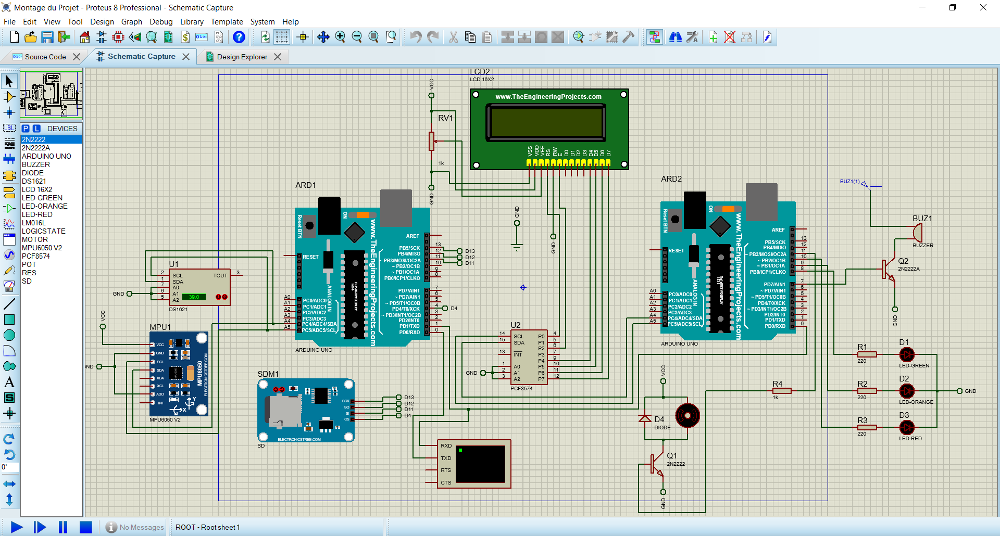

# Surveillance vibratoire et thermique d'une machine

## Présentation

Ce projet porte sur la conception et la simulation d'un système de surveillance
vibratoire et thermique d'une machine à l'aide de deux cartes Arduino UNO.
La première carte relève la température avec un capteur DS1621 et les
accélérations selon trois axes avec un module de la famille MPU6050. Elle peut
enregistrer les mesures sur une carte microSD. La seconde carte assure la
supervision : elle affiche la température, l'indicateur de vibration et l'état
de la machine, puis commande des voyants, un buzzer et un actionneur.

Le montage Proteus illustre l'utilisation de trois bus de communication :

- **I2C** pour les capteurs et l'afficheur LCD via l'extension visible sur le
  schéma ;
- **SPI** pour l'accès à la carte microSD ;
- **UART** pour l'échange de mesures entre les deux cartes Arduino.

Le dépôt contient le schéma Proteus, deux sketches Arduino et des captures de
la simulation.

## Architecture

1. **Acquisition** — Arduino 1 interroge le DS1621 et le capteur
   accélérométrique par I2C.
2. **Enregistrement** — les mesures sont écrites dans `log.txt` sur la carte
   microSD, lorsque celle-ci est initialisée.
3. **Transmission et supervision** — l'architecture du montage prévoit le
   transfert des mesures vers Arduino 2 par UART. Cette carte affiche les
   valeurs sur le LCD et pilote les sorties d'alerte.

Dans le sketch de supervision, l'état est déterminé ainsi :

| État | Condition | Indication prévue |
|---|---|---|
| **NORMAL** | Vibration inférieure ou égale à 0,15 | LED verte |
| **VIBRATION** | Vibration supérieure à 0,15, sans condition critique | LED orange et buzzer |
| **CRITIQUE** | Vibration supérieure à 0,15 et température supérieure à 40 °C | LED rouge, buzzer et moteur de sécurité |

Les seuils sont définis dans le sketch d'Arduino 2. Une erreur de capteur est
également signalée par le programme de supervision.

## Captures de la simulation

### Schéma général du montage

Le schéma Proteus présente les deux Arduino UNO, le capteur de température,
le module accélérométrique, le lecteur microSD, l'afficheur LCD et les sorties
de signalisation et d'actionnement.

### Fonctionnement normal

L'écran LCD indique l'état **NORMAL** lorsque l'indicateur de vibration ne
dépasse pas le seuil. La console virtuelle montre les mesures et la
confirmation de l'enregistrement sur la carte SD.

### Détection de vibrations

Lorsque l'indicateur de vibration dépasse le seuil, l'écran passe à
**VIBRATION** et la signalisation correspondante est activée.

### État critique

La combinaison d'une vibration supérieure au seuil et d'une température
supérieure à 40 °C déclenche l'état **CRITIQUE**, avec les sorties d'alerte et
de sécurité prévues.

## Fichiers du projet

- `Montage du Projet.pdsprj` — schéma Proteus.
- `arduino 1/sketch_sep28b/sketch_sep28b.ino` — acquisition des mesures et
  enregistrement microSD.
- `arduino 2/sketch_oct10a/sketch_oct10a.ino` — supervision, affichage LCD et
  commande des sorties.
- `Project Backups/` — sauvegardes du projet Proteus.

## Remarque sur la liaison UART

Les captures présentent une transmission de trames de mesures dans la
simulation. Dans les sketches actuellement fournis, Arduino 2 attend une ligne
au format `T:<température>;V:<vibration>`, mais le sketch d'Arduino 1 affiche
pour l'instant les mesures et les messages SD sur le port série sans émettre
cette trame. Les deux sketches doivent donc être synchronisés sur ce format
avant de reproduire la liaison UART avec les programmes tels quels.
